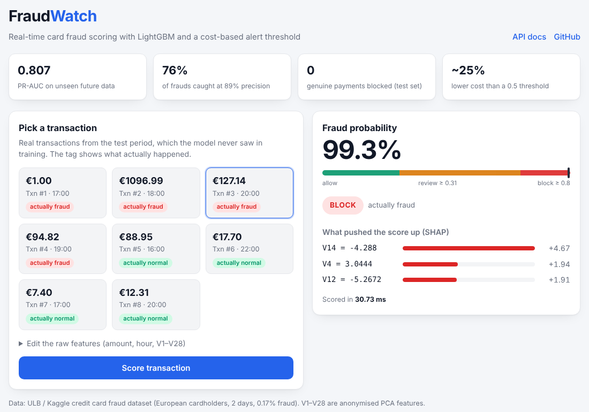
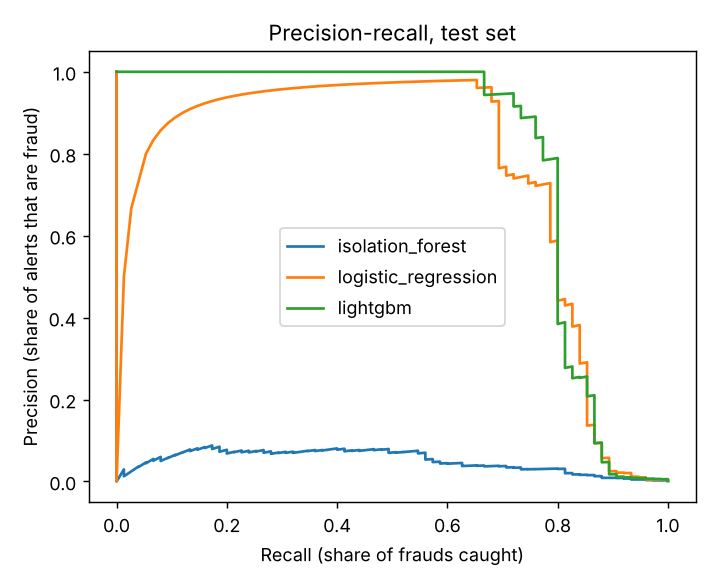
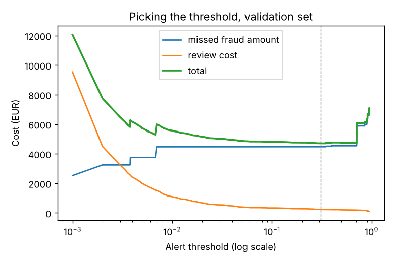

# FraudWatch

**Live demo:** https://fraudwatch-18ue.onrender.com (free tier, first load can take ~50 s to wake up)



Card transaction fraud detection on the Kaggle / ULB "Credit Card Fraud Detection" dataset (284,807 European card transactions over 2 days, only 492 frauds = 0.17%). The model scores each transaction, and a policy decides to allow it, send it to an analyst, or block it.

What I focused on:

- **Split by time.** Train on the first 60% of transactions, validate on the next 20%, test on the last 20%. That's closer to real life than a random split, because the model is always predicting the future.
- **Not using accuracy.** A model that says "never fraud" is 99.8% accurate. I used PR-AUC, precision@k and a money-based cost instead.
- **Choosing the threshold by cost, not 0.5.** Every alert costs analyst time (I assumed €5 per review), and every missed fraud costs its amount. I picked the threshold with the lowest total cost on the validation set.

## Results (test set: last ~8 hours, 56,962 transactions, 75 frauds)

| model | PR-AUC | ROC-AUC | precision@100 | recall at 80% precision |
|---|---|---|---|---|
| Isolation Forest (no labels) | 0.051 | 0.954 | 0.06 | 0.00 |
| Logistic regression (balanced) | 0.748 | 0.983 | 0.59 | 0.69 |
| LightGBM | **0.807** | 0.983 | 0.60 | **0.77** |

ROC-AUC looks great for every model, even the useless one. PR-AUC shows the real difference, which is why I report it.

**Threshold choice (LightGBM, test set):**

| threshold | alerts | frauds caught | false alerts | fraud € missed | total cost € |
|---|---|---|---|---|---|
| no model | 0 | 0 / 75 | 0 | 7,729 | 7,729 |
| default 0.5 | 57 | 54 | 3 | 3,675 | 3,960 |
| cost-based 0.31 (picked on validation) | 64 | 57 | 7 | 2,638 | **2,958** |

The cost-based threshold cuts total cost by about 25% compared with 0.5, at the price of 7 extra alerts.

**Policy:** score ≥ 0.8 → block, 0.31–0.8 → analyst review, below 0.31 → allow. On the test set:

- Blocked: 46 transactions, all 46 fraud (no genuine customer blocked).
- Review: 18 transactions, 11 fraud.
- Allowed: 56,898 transactions, 18 fraud got through.

Most important features by SHAP: V14, V4, V8, V12, then hour and amount. The V columns are PCA components (the bank anonymised the originals), so I can say which component pushed a score up, but not what it means in plain terms.




## API

`POST /score` takes `amount`, `hour` and `v1`..`v28`, and returns the fraud probability, the decision, the top 3 features that pushed the score up, and the latency (about 4 ms per transaction on my machine). `GET /examples` returns 8 real transactions from the test period so the API is easy to try. `/` is a small demo page.

## Running it

```
pip install -r requirements.txt
set PYTHONPATH=src                 (macOS/Linux: export PYTHONPATH=src)
python -m fraudwatch.train         downloads the data (~100 MB) on the first run
pytest
uvicorn fraudwatch.api:app --reload
```

## Files

- `src/fraudwatch/data.py` - loading, features (log amount, hour), time split
- `src/fraudwatch/models.py` - logistic regression, isolation forest, lightgbm, SHAP reasons
- `src/fraudwatch/metrics.py` - PR-AUC, precision@k, cost at a threshold, best threshold
- `src/fraudwatch/policy.py` - allow / review / block
- `src/fraudwatch/train.py` - trains everything, writes reports/ and models/
- `src/fraudwatch/api.py` - FastAPI
- `tests/` - 12 tests on generated data

## Limitations / todo

- Only 2 days of data, and the test set has just 75 frauds, so the numbers move a lot with small changes.
- No customer history in this dataset. Real UPI/card systems use velocity features (transactions in the last hour, new device, new payee), which would probably matter more than anything here.
- The €5 review cost is my assumption. The threshold should be re-picked with the bank's real numbers.
- The probabilities aren't calibrated. That's fine for ranking, but I'd calibrate them before using them as real probabilities.
